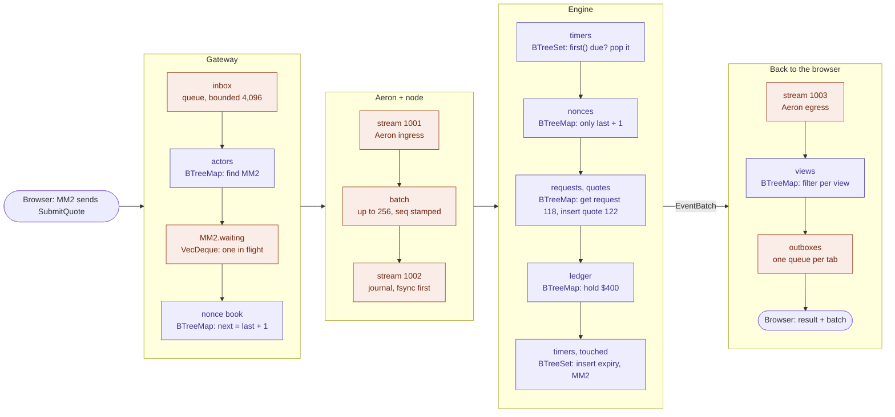

# Queues and BTrees: one command's path

How one command moves through the system, and which data structure holds it at each step. The example is MM2 quoting $0.60 on Alice's request 118 (the happy path in [demo.md](../demo.md)).

Coral: a queue (first in, first out, bounded). Purple: a `BTreeMap` or `BTreeSet` (lookup by key, iteration in key order).

1. **Gateway.** The WebSocket thread puts the frame in the bounded `inbox`; when it is full, the thread blocks. The hub finds MM2 in `actors` (`BTreeMap<AccountId, Actor>`) and appends to MM2's own `waiting` queue (`VecDeque`, at most 1,024). An account has one command in flight at a time, so its nonces stay in order. The nonce book (`BTreeMap<AccountId, Entry>`) gives `last + 1` ([gateway.md §5](../specs/gateway.md)).
2. **Aeron and the node.** Three queues in a row: ingress (stream 1001, shared memory), the node's `batch` (up to 256 commands, each stamped with `seq` and time by the sequencer), and the journal (stream 1002, recorded and fsynced by the Archive before anything is applied) ([transport-aeron.md](../specs/transport-aeron.md)).
3. **Engine.** Only BTrees ([engine.md](../specs/engine.md)):
   - `timers` (`BTreeSet<(Timestamp, TimerKey)>`) is the engine's priority queue: `first()` is the earliest deadline, and every due timer is popped before the command runs. Timers sharing a deadline fire in `TimerKey` order.
   - `nonces` (`BTreeMap<AccountId, u64>`) accepts only `last + 1`.
   - `requests` and `quotes` (`BTreeMap` by id): read request 118, insert quote 122 (its id is its `seq`). Each leg keeps its live quotes in a `BTreeSet<QuoteId>`, which selection later walks in id order.
   - The ledger (`BTreeMap`s of balances and holds) moves $400 from MM2's `free` to `reserved` under a new hold.
   - The quote's expiry goes into `timers`, and MM2 into the ledger's `touched` set, which lists the balances the batch reports, in account order.
4. **Back out.** The `EventBatch` goes on egress (stream 1003). The gateway matches its origin to MM2's command in flight and answers that tab, filters the batch once per view (`views`, `BTreeMap<ConnId, View>`), and queues each copy on that tab's outbox (at most 8,192 frames; a tab that stops reading is closed, not waited for).

**Why queues at the edges.** A queue sits wherever one part hands work to the next. It keeps arrival order, which the sequencer turns into `seq`, and each one is bounded, so overload pushes back instead of piling up.

**Why BTrees for state.** Lookups are by key, and iteration is always in key order. The engine's output therefore has the same order on every run (events, balances in each batch, the winner of a price tie), and a replay ends with the same state hash. A `HashMap` would iterate in a different order on each run ([architecture §3](overview.md)).

A deadline goes through the same path without the gateway. When nothing else arrives and `next_timer()` is due, the node sequences a `Tick`. The engine pops the deadline from `timers` and walks the leg's quote set to pick the lowest `(price, id)`.
