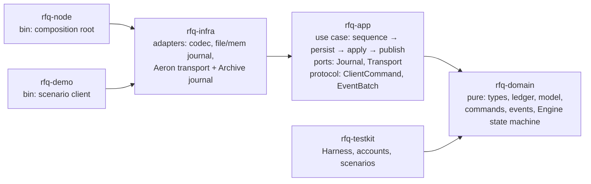
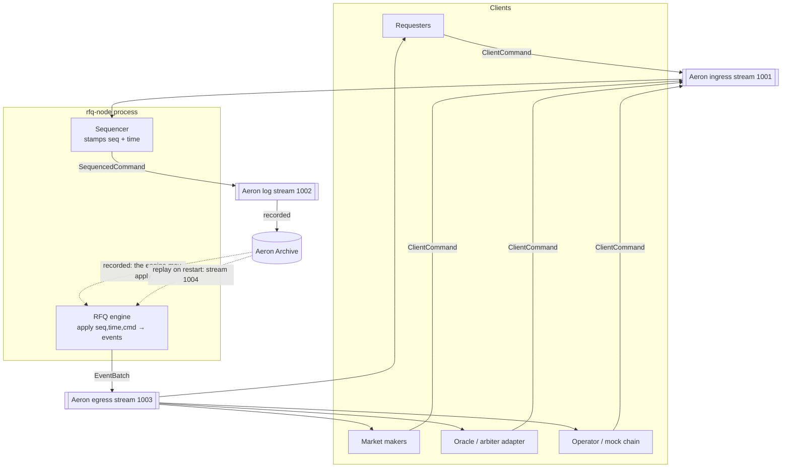
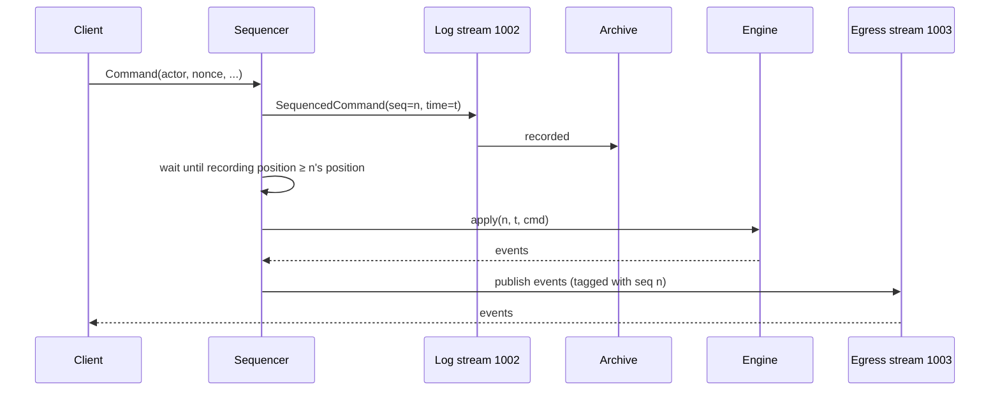
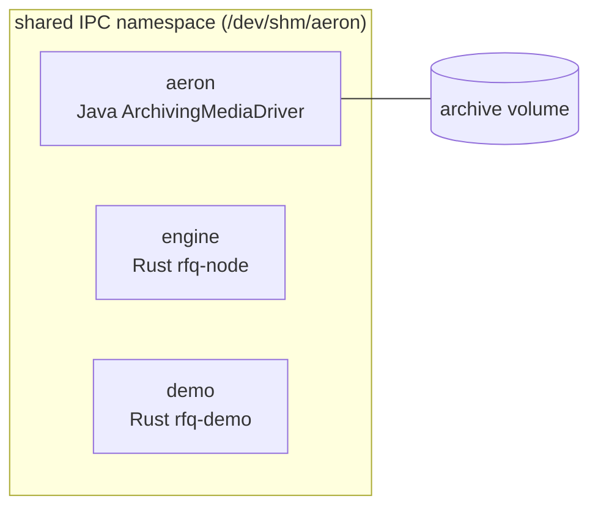
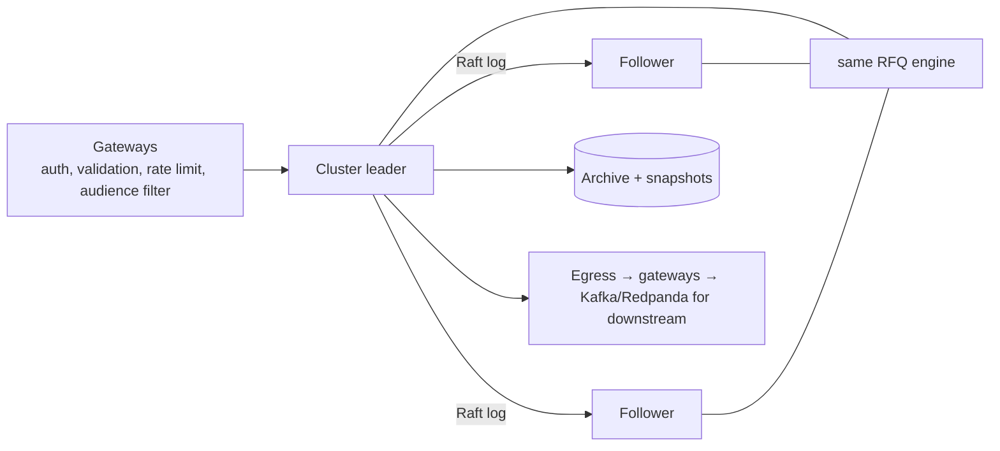
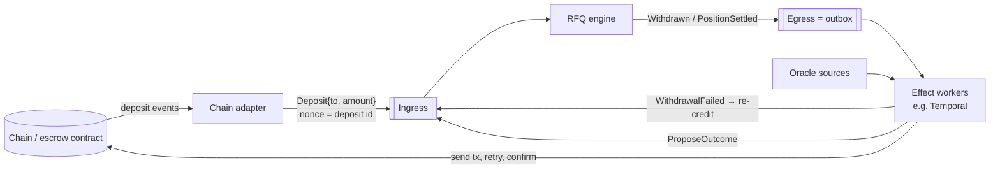

# Architecture Overview

## 0. Project structure and layers

The project uses a flat `crates/` workspace with a virtual root manifest, as described in [matklad, "Large Rust Workspaces"](https://matklad.github.io/2021/08/22/large-rust-workspaces.html). Code is split into hexagonal (ports-and-adapters) layers, and **dependencies point inward only**. Crate boundaries enforce that, not convention.



| Layer | Crate | Contains | Must not depend on |
|---|---|---|---|
| Domain | `rfq-domain` | Value objects (`Amount`, `Price`, ids), `Ledger`, entities (`Request`, `Quote`, `Contract`, `Position`), `Command`/`Event`, `Engine` (the deterministic state machine and its invariants) | Any I/O, async, clock, transport or serialization *format*. `serde` derives only; `bincode` is used solely for `state_hash` |
| Application | `rfq-app` | **Ports** (`Journal`, `Transport` traits), **protocol DTOs** (`ClientCommand`, `EventBatch`), `Sequencer`, `Node` service (write-ahead loop), `NodeError` (`thiserror`) | Concrete adapters, bincode, Aeron |
| Infrastructure | `rfq-infra` | **Adapters**: `codec` (versioned bincode), `FileJournal`, `MemJournal`, `MemTransport`, and (feature `aeron`) `AeronTransport` and `ArchiveJournal`. Also the Aeron-path pieces that need no Aeron and so are always built and tested: fragment `Reassembler`, egress `split_batch` | Binaries |
| Interface / composition | `rfq-node`, `rfq-demo` | `main`: config from env, wire adapters into `Node`, run. `anyhow` lives only here | — |
| Test support | `rfq-testkit` | `Harness`, well-known accounts, scripted scenarios and `demo_config()`. A dev-dependency of the domain and infra tests; `rfq-node` and `rfq-demo` depend on it normally, for the demo genesis and the scenarios | — |

Rules:
- **Ports carry typed values, not bytes.** `Transport` yields `ClientCommand` and accepts `EventBatch`; decoding and malformed-message handling belong to the adapter. Because the application can't even express a client-sent `Tick` or `Genesis`, injecting one is impossible by construction.
- **Errors:** library crates use `thiserror` enums. Ports return `Result<_, BoxError>`, where `BoxError = Box<dyn Error + Send + Sync>`, so the application isn't generic over adapter error types. Binaries use `anyhow`.
- **The risky dependency is isolated:** `rusteron` is behind `rfq-infra`'s `aeron` feature, so `cargo test` for domain/app/infra never builds Aeron.
- **Workspace hygiene:** `[workspace.package]` (edition 2024, version, `rust-version`, license), `[workspace.dependencies]`, `rust-toolchain.toml`, `rustfmt.toml`, `clippy.toml`, `deny.toml`, `.github/workflows/ci.yml`, `LICENSE` (MIT). Every crate is `publish = false`.

## 1. Shape

One **deterministic engine** consumes a **totally-ordered command log** and produces **events**. Aeron moves the bytes; Aeron Archive records the log; replaying the log rebuilds state exactly.



| Component | Where | Responsibility | Depends on |
|---|---|---|---|
| **Engine** | `rfq-domain::Engine` | Pure state machine: ledger, requests, quotes, contracts, timers. No I/O, no clock. | nothing |
| **Sequencer** | `rfq-app::Sequencer` | Stamps each command with a consecutive `seq` and a monotonic `time` (wall clock, clamped, resumed from the journal). Pure, no I/O. | engine types |
| **Node runtime** | `rfq-app::Node` | Startup replay, then the live loop: poll → sequence → append → wait durable → apply → publish. Sequences `Resume` after a restart and `Tick` when idle with a due timer. Latches `NodeError::Halted` on any port failure. | the ports |
| **Ports** | `rfq-app::{Journal, Transport}` | Traits over the durable log and over client ingress / event egress, carrying typed values. | engine types |
| **Codec** | `rfq-infra::codec` | Versioned binary encoding of commands, events and journal records (`serde` + `bincode`). Size limit only at untrusted ingress. | engine and protocol types |
| **Journal adapters** | `rfq-infra::journal`, `rfq-infra::aeron` | `ArchiveJournal` = Aeron Archive recordings of stream 1002; `FileJournal`; `MemJournal` | Aeron Archive client (`aeron` feature) |
| **Transport adapters** | `rfq-infra::transport`, `rfq-infra::aeron` | `AeronTransport` = ingress 1001, egress 1003; `MemTransport` | Aeron client (`aeron` feature) |
| **Composition root** | `rfq-node` | Reads `AERON_DIR`, `RFQ_JOURNAL`, `RFQ_HASH_EVERY_BATCH`; wires an Aeron transport and a journal into `Node`; runs the loop. | all of the above |
| **Demo client** | `rfq-demo` | Runs the scripted scenarios over Aeron as an ordinary client and checks the events it gets back. | codec, Aeron client, testkit |

## 2. The engine boundary (the one interface that matters)

```rust
pub struct SequencedCommand { pub seq: u64, pub time: Timestamp, pub cmd: Command }

pub enum Command { Genesis(Genesis), Tick, Resume, User { actor: AccountId, nonce: u64, action: Action } }

impl Engine {
    pub fn new() -> Self;                                         // empty; first command must be Genesis
    pub fn apply(&mut self, sc: &SequencedCommand) -> Vec<Emitted>; // never panics on bad input
    pub fn next_timer(&self) -> Option<Timestamp>;                 // sequencer ticks only when due
    pub fn state_hash(&self) -> [u8; 32];                          // replay verification
    pub fn check_invariants(&self) -> Result<(), String>;          // tests + debug builds
}
```

Everything outside this line (Aeron, Docker, Archive, Cluster later) is plumbing. Tests drive `apply` directly.

## 3. Determinism rules

1. Engine never reads a clock; `time` comes from the `SequencedCommand`.
2. Before applying any command, the engine fires all timers with `deadline <= time` (in `(deadline, key)` order). The one exception is `Resume`, which acts first so that downtime can't eat a dispute window ([engine.md §6.3](../specs/engine.md)).
3. No randomness. IDs are derived from `seq` (`RequestId(seq)`, `QuoteId(seq)`).
4. `BTreeMap`/`BTreeSet` for all iterated state.
5. Genesis config (roles, limits) is the first log entry, so replay uses identical config.

## 4. Live loop and durability



**Write-ahead rule:** nothing is applied or published before its command is durably recorded. A batch (up to `MAX_BATCH` client commands) shares one durability wait; the whole batch is applied before any of it is published. If the engine crashes:

| Crash point | Effect | Recovery |
|---|---|---|
| Before log publish | Command never happened. | Client retries with same nonce. |
| After record, before apply | Command is in the log. | Replay applies it. |
| After apply, before egress | Memory is lost; the journal is not. | Replay re-derives the state with egress **suppressed**, so a batch that was not published is not re-published. Its events are derivable from the journal, and consumers reconcile from state or the log (`EventBatch.origin` matches a client's own command). |

## 5. Deployment (Docker Compose)



- `aeron`: `eclipse-temurin:21-jre` and the pinned `aeron-all` 1.53.3 jar; runs the media driver and the Archive; `ipc: shareable`, `shm_size: 512m`.
- `engine`, `demo`: Rust images from `docker/rust.Dockerfile` (`--features aeron`, `--locked`); `ipc: "service:aeron"` so all share `/dev/shm/aeron`; `init: true`. All channels are `aeron:ipc`. The `demo` service sits in compose profile `demo` and runs on demand (`docker compose run --rm demo [scenario]`).
- Archive data is on the named volume `archive`, so it survives the engine being killed and restarted. `./scripts/demo.sh` does exactly that: it runs the six scenarios, `SIGKILL`s the engine, restarts it, and checks that the replayed state hash equals the last hash the engine logged before the kill (`RECOVERY OK`).

## 6. Production path (not built)



Swap `Sequencer + ArchiveJournal` for Aeron Cluster's ingress/log; the engine becomes the `ClusteredService` unchanged. Cluster timers replace `Tick`.

## 7. Chain and external effects (production, not built)

The brief says to mock the chain, so in this build the ledger's `escrowed` bucket is the escrow, and `Deposit` (operator) and `Withdrawn` (event) are the only places money enters or leaves. Those two points are the seam where real systems attach. **The engine decides and records; workers at the edges carry out side effects.**



### Escrow contract

| | Engine as escrow (this build, custodial) | On-chain escrow contract (non-custodial) |
|---|---|---|
| Who holds funds | The venue's ledger | A smart contract |
| What prevents theft | Invariants I1–I5, audit log, replay | Contract code: users sign orders (EIP-712); the contract checks both signatures and locks both sides in one transaction |
| Engine's role | Match and settle | Match only, then submit the signed match for on-chain settlement |

This is the hybrid model Polymarket uses: matching off-chain, settlement on-chain against conditional-token collateral. Moving to it doesn't change the engine. Escrow amounts and payouts are already exact integers (`qty × p` / `qty × (1−p)`), so the contract can verify them directly.

**Rules for the chain adapter:**
- **Exactly-once deposits:** nonces are strict (`nonce == last + 1`), so the adapter submits finalized deposits in chain order with consecutive operator nonces and durably records `deposit id → nonce` before sending. After a crash it re-sends from its record: `Duplicate` means already applied, and `NonceGap` means an earlier deposit is missing, so it can never double-credit or skip one.
- **Wait for finality:** only deposits past the chain's finality depth are sent, so a chain reorg can't take back money the engine has already credited.
- **Withdrawals go through an outbox:** a `Withdraw` debits the ledger and emits `Withdrawn` in the same command. The egress log is the outbox. A worker sends the transaction idempotently, keyed by `seq`. If the transaction ultimately fails, the worker submits a `WithdrawalFailed` command that re-credits the account, so the funds are never lost between ledger and chain. That command would be a new one, added only when the chain is real.

### Temporal (or any durable workflow engine)

**Not for the core.** Temporal's durable state, timers and replay are what the sequenced log, timers-as-data and Archive replay already provide. Its natural model is one workflow per request, but the ledger is shared across requests (one MM's capital backs quotes on many). Moving money between workflows would need distributed transactions, which is exactly where capital leaks. Every step would also become a round-trip to the Temporal server.

**Good at the edges**, for side effects that call outside systems and need retries:
- withdrawal and settlement transactions (send, retry, confirm, reconcile)
- oracle polling, then submitting `ProposeOutcome`
- notifications to requesters and MMs

Each worker reads egress events and writes commands back to ingress. It's just another client of the engine, so the engine's determinism and replay guarantees are untouched.

## 8. Scaling

- **Measured (engine only):** `cargo bench -p rfq-domain` replays a 100,005-command log through `Engine::apply` at **~3.7 million commands/s**, about 270 ns per command. Machine: Apple M4 Max, macOS 27.0.1, rustc 1.99.0, bench profile (release with `overflow-checks` on), one thread. `state_hash` over the final state (20,000 requests, 40,000 quotes) takes **~11.9 ms**: it hashes the whole state, so it is for snapshots and replay checks, not for every command.
- **What that number is not.** The workload is 20,000 sequential full RFQ rounds (request, two quotes, tick, accept; all filled) on 3 funded accounts and 1 contract, one request in flight at a time. It is the engine alone: no codec, no fsync or Archive write, no Aeron. Both runs were taken while other builds kept the machine at load average 8 to 12, so read the figure as a rough order of magnitude (the two runs agreed within 1%). End-to-end throughput and latency over Aeron and the Archive were not measured; the durability wait, not the engine, is where that limit is expected to be.
- **Scaling claim.** Engine state is in `BTreeMap`/`BTreeSet`s (accounts, requests, quotes, positions, and the timer set), so a lookup or insert touches O(log n) entries. The benchmark does not test how that holds for much larger state than the one log above.
- Built in now: a timer index (`BTreeSet<(Timestamp, TimerKey)>`), ticks only when a timer is due, and events emitted once (gateways fan them out).
- Designed but not built: pruning terminal objects from memory, and snapshots.
- Beyond one engine: **shard by contract group**. Each shard holds its own sub-balance per account; cross-shard transfers are two-step with an `in_transit` bucket. Multi-leg requests must stay within one shard — cross-shard atomicity would need 2PC, which is exactly where capital leaks.
