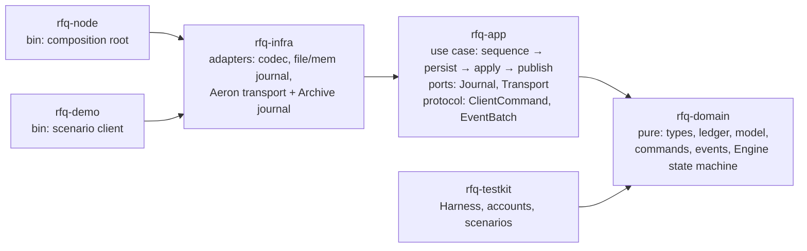
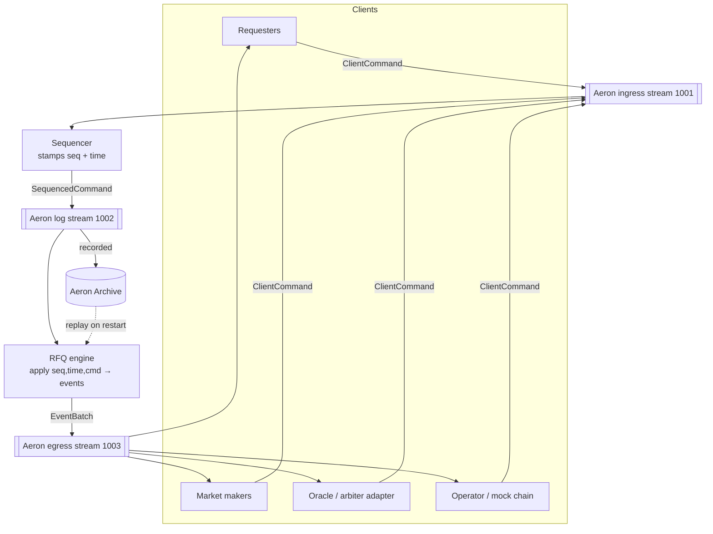
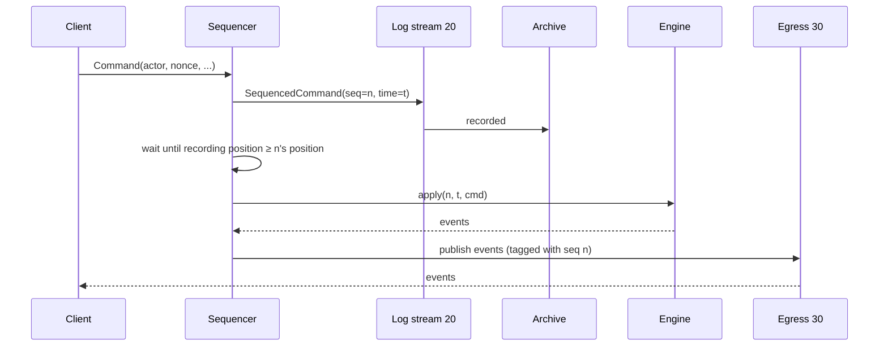
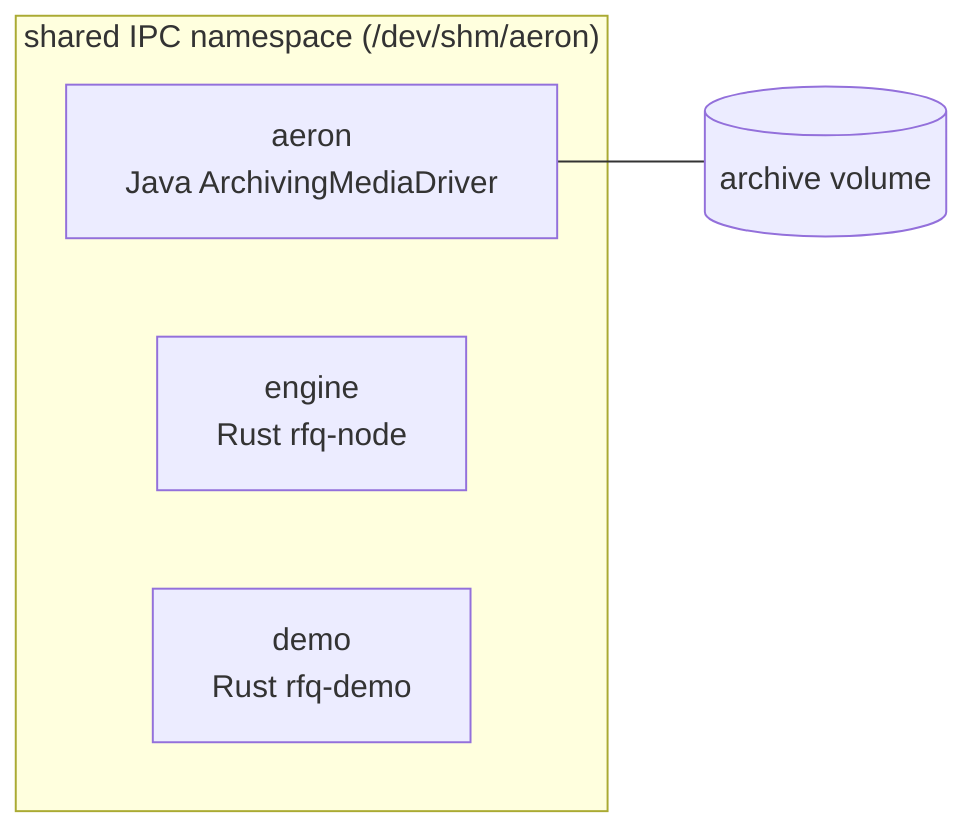
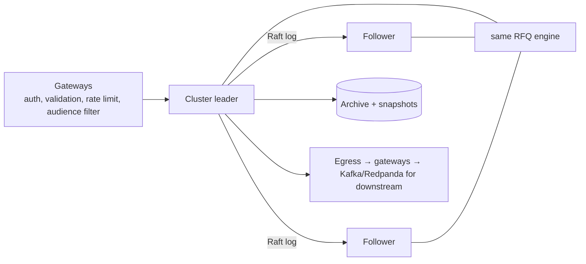
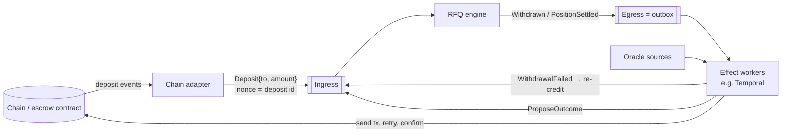

# Architecture Overview

## 0. Project structure and layers

The project uses a flat `crates/` workspace with a virtual root manifest, as described in [matklad, "Large Rust Workspaces"](https://matklad.github.io/2021/08/22/large-rust-workspaces.html). Code is split into hexagonal (ports-and-adapters) layers, and **dependencies point inward only**. Crate boundaries enforce that, not convention.



| Layer | Crate | Contains | Must not depend on |
|---|---|---|---|
| Domain | `rfq-domain` | Value objects (`Amount`, `Price`, ids), `Ledger`, entities (`Request`, `Quote`, `Contract`, `Position`), `Command`/`Event`, `Engine` (the deterministic state machine and its invariants) | Any I/O, async, clock, transport or serialization *format*. `serde` derives only; `bincode` is used solely for `state_hash` |
| Application | `rfq-app` | **Ports** (`Journal`, `Transport` traits), **protocol DTOs** (`ClientCommand`, `EventBatch`), `Sequencer`, `Node` service (write-ahead loop), `NodeError` (`thiserror`) | Concrete adapters, bincode, Aeron |
| Infrastructure | `rfq-infra` | **Adapters**: `codec` (versioned bincode), `FileJournal`, `MemJournal`, `MemTransport`, and (feature `aeron`) `AeronTransport` and `ArchiveJournal` | Binaries |
| Interface / composition | `rfq-node`, `rfq-demo` | `main`: config from env, wire adapters into `Node`, run. `anyhow` lives only here | — |
| Test support | `rfq-testkit` | `Harness`, well-known accounts, scripted scenarios (dev-dependency of the others) | — |

Rules:
- **Ports carry typed values, not bytes.** `Transport` yields `ClientCommand` and accepts `EventBatch`; decoding and malformed-message handling belong to the adapter. Because the application can't even express a client-sent `Tick` or `Genesis`, injecting one is impossible by construction.
- **Errors:** library crates use `thiserror` enums. Ports return `Result<_, BoxError>`, where `BoxError = Box<dyn Error + Send + Sync>`, so the application isn't generic over adapter error types. Binaries use `anyhow`.
- **The risky dependency is isolated:** `rusteron` is behind `rfq-infra`'s `aeron` feature, so `cargo test` for domain/app/infra never builds Aeron.
- **Workspace hygiene:** `[workspace.package]` (edition 2024, version, license), `[workspace.dependencies]`, `rust-toolchain.toml`, `rustfmt.toml`, `clippy.toml`, `deny.toml`, `.github/workflows/ci.yml`.

## 1. Shape

One **deterministic engine** consumes a **totally-ordered command log** and produces **events**. Aeron moves the bytes; Aeron Archive records the log; replaying the log rebuilds state exactly.



| Component | Crate | Responsibility | Depends on |
|---|---|---|---|
| **Engine** | `rfq-core` | Pure state machine: ledger, requests, quotes, contracts, timers. No I/O, no clock. | nothing |
| **Codec** | `rfq-core::codec` | Versioned binary encoding of commands/events (`serde` + `bincode`). | engine types |
| **Sequencer** | `rfq-node` | Reads ingress, assigns `seq` (monotonic) and `time` (monotonic, from wall clock), publishes to log stream, emits `Tick` when idle. | Aeron client |
| **Journal** | `rfq-node` | Trait over the durable log. `ArchiveJournal` = Aeron Archive recording of stream 20. | Aeron Archive client |
| **Node runtime** | `rfq-node` | Startup replay → live loop: sequence → wait for record → apply → publish events. | all above |
| **Demo client** | `rfq-demo` | Runs scripted scenarios over Aeron, prints events, asserts outcomes. | codec, Aeron client |

## 2. The engine boundary (the one interface that matters)

```rust
pub struct SequencedCommand { pub seq: u64, pub time: Timestamp, pub cmd: Command }

pub enum Command { Genesis(Genesis), Tick, Resume, User { actor: AccountId, nonce: u64, action: Action } }

impl Engine {
    pub fn new() -> Self;                                         // empty; first command must be Genesis
    pub fn apply(&mut self, sc: &SequencedCommand) -> Vec<Emitted>; // never panics on bad input
    pub fn next_timer(&self) -> Option<Timestamp>;                 // sequencer ticks only when due
    pub fn state_hash(&self) -> [u8; 32];                          // replay verification
    pub fn check_invariants(&self) -> Result<(), String>;          // tests + debug builds
}
```

Everything outside this line (Aeron, Docker, Archive, Cluster later) is plumbing. Tests drive `apply` directly.

## 3. Determinism rules

1. Engine never reads a clock; `time` comes from the `SequencedCommand`.
2. Before applying any command, the engine fires all timers with `deadline <= time` (in `(deadline, key)` order).
3. No randomness. IDs are derived from `seq` (`RequestId(seq)`, `QuoteId(seq)`).
4. `BTreeMap`/`BTreeSet` for all iterated state.
5. Genesis config (roles, limits) is the first log entry, so replay uses identical config.

## 4. Live loop and durability



**Write-ahead rule:** no event is published before its command is durably recorded. If the engine crashes:

| Crash point | Effect | Recovery |
|---|---|---|
| Before log publish | Command never happened. | Client retries with same nonce. |
| After record, before apply | Command is in the log. | Replay applies it. |
| After apply, before egress | State not persisted anyway (memory). | Replay re-derives state; events re-published from replay position on reconnect; consumers dedupe by `seq`. |

## 5. Deployment (Docker Compose)



- `aeron`: `eclipse-temurin` JRE + pinned `aeron-all` jar; runs media driver + archive; `ipc: shareable`.
- `engine`, `demo`: Rust images; `ipc: "service:aeron"` so all share `/dev/shm/aeron`. All channels are `aeron:ipc`.
- Archive data on a named volume → survives `docker compose restart engine` (used by the crash-recovery demo).

## 6. Production path (not built)



Swap `Sequencer + ArchiveJournal` for Aeron Cluster's ingress/log; the engine becomes the `ClusteredService` unchanged. Cluster timers replace `Tick`.

## 7. Chain and external effects (production, not built)

The brief says to mock the chain, so in this build the ledger's `escrowed` bucket is the escrow, and `Deposit` (operator) and `Withdrawn` (event) are the only places money enters or leaves. Those two points are the seam where real systems attach. **The engine decides and records; workers at the edges carry out side effects.**



### Escrow contract

| | Engine as escrow (this build, custodial) | On-chain escrow contract (non-custodial) |
|---|---|---|
| Who holds funds | The venue's ledger | A smart contract |
| What prevents theft | Invariants I1–I5, audit log, replay | Contract code: users sign orders (EIP-712); the contract checks both signatures and locks both sides in one transaction |
| Engine's role | Match and settle | Match only, then submit the signed match for on-chain settlement |

This is the hybrid model Polymarket uses: matching off-chain, settlement on-chain against conditional-token collateral. Moving to it doesn't change the engine. Escrow amounts and payouts are already exact integers (`qty × p` / `qty × (1−p)`), so the contract can verify them directly.

**Rules for the chain adapter:**
- **Exactly-once deposits:** nonces are strict (`nonce == last + 1`), so the adapter submits finalized deposits in chain order with consecutive operator nonces and durably records `deposit id → nonce` before sending. After a crash it re-sends from its record: `Duplicate` means already applied, and `NonceGap` means an earlier deposit is missing, so it can never double-credit or skip one.
- **Wait for finality:** only deposits past the chain's finality depth are sent, so a chain reorg can't take back money the engine has already credited.
- **Withdrawals go through an outbox:** a `Withdraw` debits the ledger and emits `Withdrawn` in the same command. The egress log is the outbox. A worker sends the transaction idempotently, keyed by `seq`. If the transaction ultimately fails, the worker submits a `WithdrawalFailed` command that re-credits the account, so the funds are never lost between ledger and chain. That command would be a new one, added only when the chain is real.

### Temporal (or any durable workflow engine)

**Not for the core.** Temporal's durable state, timers and replay are what the sequenced log, timers-as-data and Archive replay already provide. Its natural model is one workflow per request, but the ledger is shared across requests (one MM's capital backs quotes on many). Moving money between workflows would need distributed transactions, which is exactly where capital leaks. Every step would also become a round-trip to the Temporal server.

**Good at the edges**, for side effects that call outside systems and need retries:
- withdrawal and settlement transactions (send, retry, confirm, reconcile)
- oracle polling, then submitting `ProposeOutcome`
- notifications to requesters and MMs

Each worker reads egress events and writes commands back to ingress. It's just another client of the engine, so the engine's determinism and replay guarantees are untouched.

## 8. Scaling

- One engine handles far more than RFQ load (commands are O(log n), no I/O).
- Built in now: a timer index (`BTreeSet<(Timestamp, TimerKey)>`), ticks only when a timer is due, and events emitted once (gateways fan them out).
- Designed but not built: pruning terminal objects from memory, and snapshots.
- Beyond one engine: **shard by contract group**. Each shard holds its own sub-balance per account; cross-shard transfers are two-step with an `in_transit` bucket. Multi-leg requests must stay within one shard — cross-shard atomicity would need 2PC, which is exactly where capital leaks.
