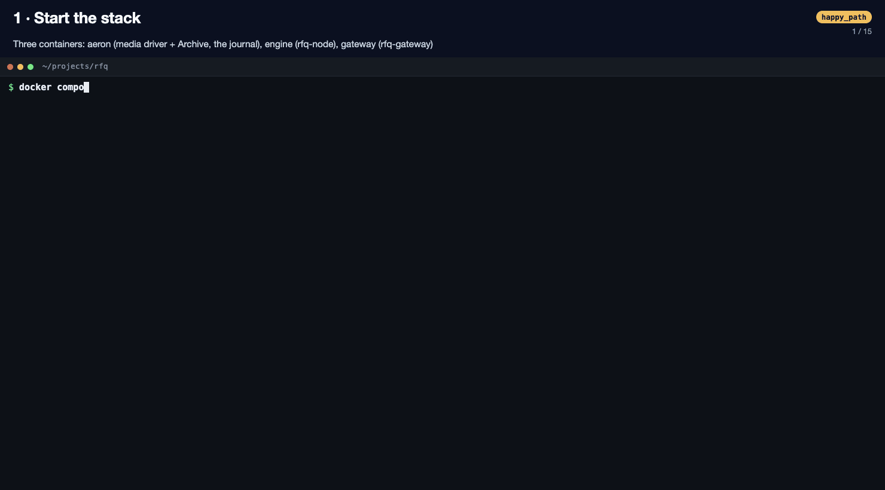
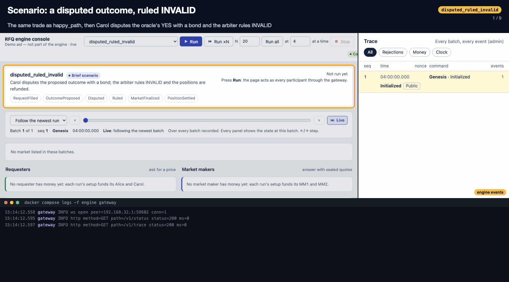
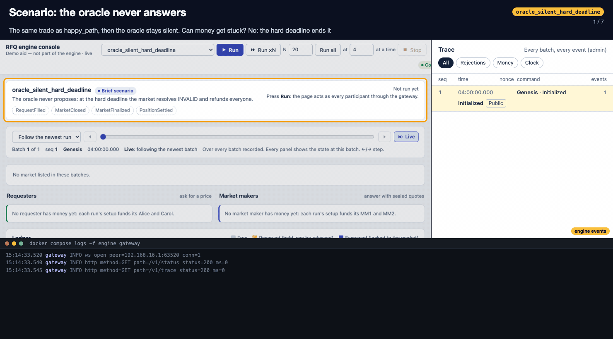
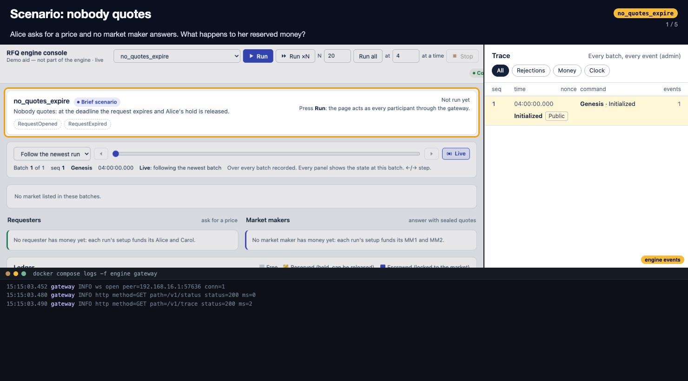
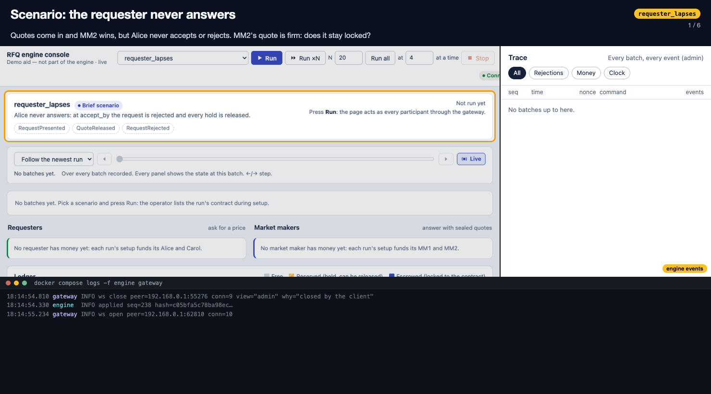

# Demo: the scenarios on the live stack

Each GIF below is one real run of a scenario from the [live dashboard](../tools/dashboard/DESIGN.md) against the Docker stack (`aeron`, `engine`, `gateway`). Every command went through the gateway, Aeron and the engine, and every number on screen came back from the engine. All five runs passed.

## How to read a frame

- **Top:** what is happening, in one line.
- **Left:** the dashboard, zoomed on the part that changed, with an amber outline. The camera moves first, then the change lands, so you see the before and the after in the same place.
- **Right, "engine events":** the dashboard's **Trace**. Each row is one `EventBatch` exactly as the engine published it:
  - its `seq`, its engine time, and the command that caused it (or `Tick` for the engine's own timers);
  - every event with its audience: `Public`, or `→ Alice` for an event only Alice receives;
  - the balances it changed.

  The newest row is outlined.
- **Bottom:** `docker compose logs -f engine gateway`. The lines for the current step are highlighted.
  - The engine logs `applied seq=N hash=…` once per command it applies. `N` is the same number as the Trace row's `seq`.
  - The gateway logs each command it sends (with its nonce) and the result it gets back.
  - A batch with no gateway line is a timer (`Tick`), not a command.
  - A `nonce sync` line, followed by an extra `applied seq`, is the gateway probing an account's next nonce before that account's first command ([gateway.md §5](specs/gateway.md)).

Time is compressed: each step is held for about 3.5 s, whatever the real gap was. Two commands can land 75 ms apart, so the state shown at each step is taken with the dashboard's timeline scrubber after the run: it is the exact state after that batch.

## Run it yourself

```bash
docker compose up -d --build aeron engine gateway
tools/dashboard/build.sh
open tools/dashboard/dist/rfq-dashboard.html
docker compose logs -f engine gateway        # in a second terminal
```

Pick a scenario, press **Run**. The same scenarios also run without the page: `docker compose run --rm demo <scenario>`.

## 1. Happy path, and how to run the project

`happy_path`: two market makers quote, the best price is presented, Alice accepts, the oracle proposes YES, nobody disputes, and the market settles.



- **Setup:** the stack starts (`docker compose up`), the page is built (`build.sh`), and the logs show the engine replaying its journal from the Archive (`replayed seq=… hash=…`; a fresh journal holds only Genesis, seq 1) and the gateway listening on :18080 (WebSocket) and :18081 (HTTP). When it opens, the page reads the history over HTTP.
- **Request:** Alice asks for 1,000 YES with a sealed $0.70 limit, so $700 is reserved.
- **Quotes:** MM1 quotes $0.62 and MM2 quotes $0.60. Each quote is sealed: only its own MM receives `QuoteSubmitted`.
- **Deadline:** a `Tick` opens the quotes. MM2 wins, MM1 gets its $380 back, and Alice is presented the price.
- **Accept:** Alice's $600 and MM2's $400 are escrowed.
- **Resolution:** trading closes, the oracle proposes YES, and the dispute window passes with no dispute. The market is final YES, and Alice is paid $1,000 in the same batch.

## 2. A dispute, ruled INVALID

`disputed_ruled_invalid`: the same trade, then Carol disputes the oracle's YES and the arbiter rules INVALID.



- **Dispute:** Carol disputes inside the 2 s window. Her $100 bond is reserved like any other money, and the market moves Proposed → Disputed.
- **Ruling:** the arbiter rules INVALID, and one batch carries `Ruled (bond_returned)`, `MarketFinalized INVALID` and a `PositionSettled` for each holder.
- **Money:** Alice gets her $600 back and MM2 its $400. The ruling differs from the oracle's proposal, so Carol was right and her bond is returned. Had the arbiter agreed with the oracle, the bond would have gone to the treasury ([resolution.md](specs/resolution.md)).

## 3. A silent oracle: INVALID at the hard deadline

`oracle_silent_hard_deadline`: the same trade, then the oracle never proposes.



- Trading closes and the market waits in Closed.
- 10 s later, a `Tick` at the hard deadline finalizes it INVALID. The log pane shows no command, only the engine applying a timer.
- Both stakes go back: Alice $600, MM2 $400. Money can never stay locked: every market is final by its hard deadline.

## 4. Nobody quotes: the request expires

`no_quotes_expire`: Alice asks for a price and no market maker answers.



- At the response deadline, a `Tick` finds no eligible quote and emits `RequestExpired`.
- Alice's $700 hold is released in the same batch.
- Request: Open → Expired.

## 5. The requester never answers: the request lapses

`requester_lapses`: quotes come in and MM2 wins, but Alice neither accepts nor rejects.



- MM2's selected quote is firm, so MM2 can't cancel it. It holds only until `accept_by`.
- At `accept_by`, a `Tick` emits `QuoteReleased → MM2` and `RequestRejected` (cause `Lapsed`, public).
- Alice's $700 and MM2's $400 are both released, and everyone is back to $1,000 free.
- Request: Presented → Rejected (Lapsed); quote: Selected → Released.
