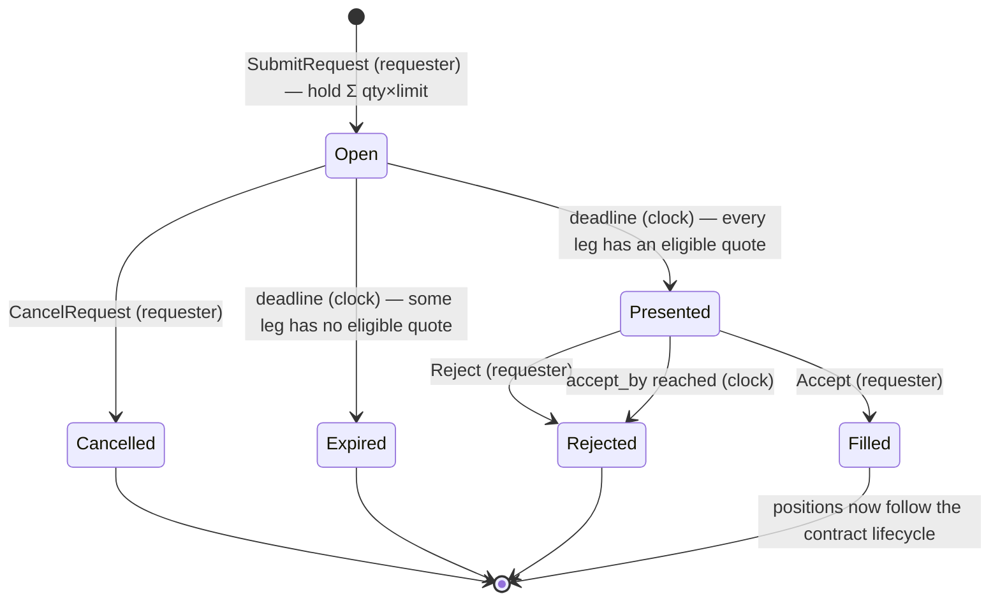
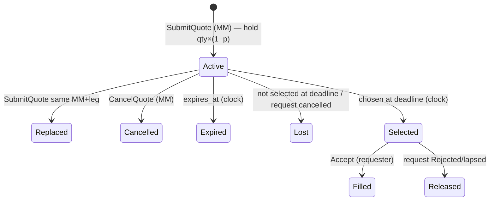
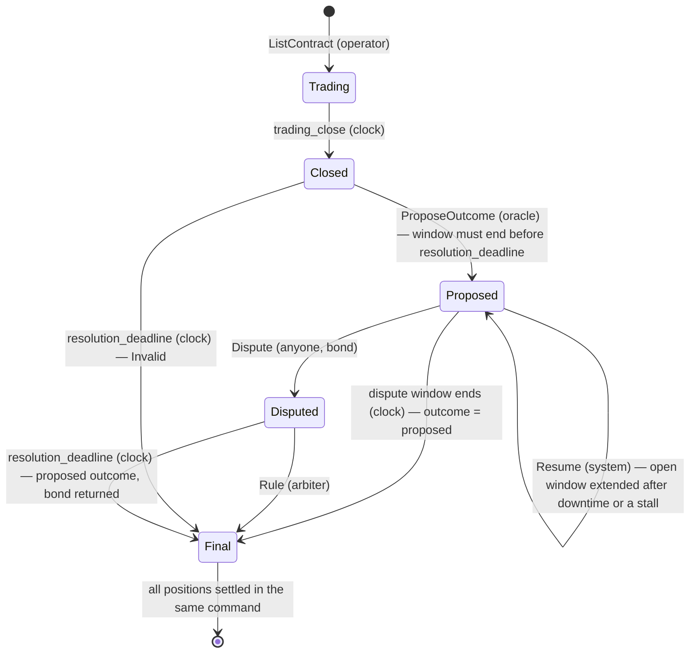

# Engine Spec

Covers deliverable **D1** (state machine) and the behaviour behind **D2**. Product decisions referenced as P#/T# are in [RFC 0001](../rfc/0001-rfq-engine.md).

## 1. Units

| Type | Repr | Notes |
|---|---|---|
| `Amount` | `u64` micro-USD | `$1 = 1_000_000`. All arithmetic `checked_*`; overflow ⇒ command rejected. |
| `Price` | `u16` bps, `1..=9999` | Price of the side the requester buys. `0` and `10000` are invalid (degenerate). |
| `Qty` | `u64` shares | `1..=MAX_QTY` (genesis config). |
| `Timestamp` / `Duration` | `u64` ms | Absolute times only in state. |

Collateral for a leg at price `p`, quantity `q`:
- buyer (requester) locks `q × p × 100`
- counterparty (MM) locks `q × (10000 − p) × 100`
- sum = `q × 1_000_000` exactly. **No rounding exists in the system.**

## 2. Roles

Set in the `Genesis` entry (first log record).

| Role | Can |
|---|---|
| Operator | `Deposit` (mock chain credit), `ListContract` |
| Any account | `Withdraw` (own free funds), `SubmitRequest`, `CancelRequest`, `SubmitQuote`, `CancelQuote`, `Accept`, `Reject`, `Dispute` |
| Contract oracle | `ProposeOutcome` for its contracts |
| Arbiter | `Rule` on disputed contracts |
| System (the node) | `Genesis` (seq 1), `Tick`, `Resume` (first command after a restart or a stall, §6.3) |

Every user command carries `actor: AccountId` and `nonce: u64`. Nonces are **strict**: the engine accepts a command only if `nonce == last_nonce[actor] + 1`. `nonce ≤ last` ⇒ `Duplicate` (it was already sequenced); `nonce > last + 1` ⇒ `NonceGap` (a predecessor is missing). Neither consumes anything. A valid nonce is consumed even if the command is then rejected for business reasons, so `Duplicate` always means "already applied" and retries are idempotent. System commands carry no nonce.

**Trust boundary.** The engine trusts `actor` as given. Authenticating it (a signature over `(actor, nonce, command)`) is the gateway's job and out of scope per the brief. `Genesis`, `Tick` and `Resume` are produced only by the node: clients send a `ClientCommand { actor, nonce, action }`, which cannot express them.

## 3. Ledger

Per account: `free`, `reserved`, `escrowed` (all `Amount`). The ledger is the **only** code that mutates balances.

| Op | Move | Used by |
|---|---|---|
| `deposit(a, x)` | external → free | `Deposit` |
| `withdraw(a, x)` | free → external | `Withdraw` |
| `hold(a, x) -> HoldId` | free → reserved | request, quote, dispute bond |
| `release(h)` | reserved → free (whole hold) | cancel, expiry, loss, rejection, bond returned |
| `escrow_from_hold(h, x)` | reserved → escrowed (`x ≤ hold`); the remainder → free | `Accept`: **once** for the requester's Σ legs, once per selected quote |
| `pay_from_escrow(from, x, to)` | escrowed(from) → free(to) | contract finalisation (each side of each position) |
| `forfeit(h, to)` | reserved(owner) → free(to) (whole hold) | bond forfeited to treasury |

**Holds are linear.** `release`, `escrow_from_hold` and `forfeit` each consume the `HoldId`; an op on a dead hold returns `UnknownHold` and never reads a stale amount. Every object keeps its hold as `Option<HoldId>` and `take()`s it, so no path can release a hold twice.

**Invariants** (checked by `check_invariants()` after every command in tests/debug):

- **I1 Conservation:** Σ over accounts (free + reserved + escrowed) = Σ deposits − Σ withdrawals.
- **I2 Holds:** `account.reserved` = Σ amounts of live holds owned by that account.
- **I3 Escrow:** `account.escrowed` = Σ unsettled position locks for that account; each unsettled position's locks sum to `qty × 1_000_000`.
- **I4 Ownership:** every live hold belongs to exactly one live object (request in `Open`/`Presented`, quote in `Active`/`Selected`, dispute pending). Terminal objects own no holds.
- **I5 No dead ends:** every live object that owns money has a pending timer whose firing moves it to a terminal state.

## 4. Domain objects

```text
Contract { id, description, oracle, trading_close, resolution_deadline, dispute_window, state,
           dispute?, positions }
Request  { id, requester, legs: Vec<Leg>, response_deadline, hold?, state }   // accept_by lives in state: Presented{accept_by}
Leg      { contract, side: BuyYes|BuyNo, qty, limit_price, quotes: live quote ids, selected? }
Quote    { id, mm, request, leg, price, size, expires_at, hold?, state }
Position { id, contract, request, qty, yes_holder, yes_lock, no_holder, no_lock, settled }
Dispute  { disputer, hold? }                                                   // held by its Contract; hold = the bond
```

`hold?` is `Some` only while the hold is live: each owner `take()`s it when the hold is released, escrowed or forfeited (§3).

Requester hold at submission = Σ legs `qty × limit_price × 100` (P4).

## 5. Commands → validation → effects

| Command | Validation (any failure ⇒ `CommandRejected`, no state change) | Effects |
|---|---|---|
| `Deposit{to, amount}` | actor is operator; `amount > 0` | ledger deposit |
| `Withdraw{amount}` | `0 < amount ≤ free` | ledger withdraw |
| `ListContract{...}` | operator; unique id; `now < trading_close < resolution_deadline`; `dispute_window > 0` and `trading_close + dispute_window < resolution_deadline` (a proposal must fit before the hard deadline, else the contract could only finalize `Invalid`); `oracle ∉ {operator, arbiter, treasury}` (role separation) | contract `Trading`; timers for close + hard deadline |
| `SubmitRequest{legs, response_deadline}` | `1 ≤ legs.len() ≤ MAX_LEGS` (8; else `InvalidInput`, P6); `now + MIN_RESPONSE ≤ deadline ≤ now + MAX_RESPONSE`; for **every** leg: contract `Trading`, `deadline + ACCEPT_WINDOW < trading_close`, qty in range, `qty × limit × 100 ≥ MIN_REQUEST_NOTIONAL` (else `InvalidInput`); free ≥ hold | hold; request `Open`; timer at deadline |
| `CancelRequest{request}` | actor = requester; state `Open` | release request + all quote holds; `Cancelled` |
| `SubmitQuote{request, leg, price, size, expires_at}` | request `Open` and `now < deadline`; `mm ≠ requester`; `leg < legs.len()` (else `InvalidInput`); `size ≥ leg.qty`; `expires_at > now`; MM free ≥ `qty × (10000−price) × 100` (net of any replaced quote). **No `price ≤ limit` check:** a rejection would be an oracle for the sealed limit; selection filters over-limit quotes and `QuoteLost` doesn't say why | `expires_at` clamped to `min(expires_at, deadline + ACCEPT_WINDOW)` (a quote is useless after that) and the clamped value used for the quote, its event and its timer; if MM already has an active quote on this leg → **replace** (release old hold, hold new) atomically; quote `Active` |
| `CancelQuote{quote}` | actor = mm; quote `Active`. A `Selected` quote is firm (P5) ⇒ `InvalidState` | release; quote `Cancelled` |
| `Accept{request, picks: [(leg, quote, price)]}` | actor = requester; state `Presented`; every leg's contract still `Trading` (else `InvalidState`); picks equal current selection exactly (one per leg, in leg order, ids **and** prices) | one `escrow_from_hold(request hold, Σ legs q×p×100)` (escrows the sum and releases the remainder once); per leg `escrow_from_hold` of the MM's whole quote hold; create positions; request `Filled`; quotes `Filled` |
| `Reject{request}` | actor = requester; state `Presented` | release all; `Rejected(Declined)` |
| `ProposeOutcome{contract, outcome}` | actor = contract oracle; state `Closed`; `now + dispute_window < resolution_deadline` (else `InvalidState`) | `Proposed{dispute_until = now + dispute_window}`; timer at `dispute_until` |
| `Dispute{contract}` | state `Proposed`; `now < dispute_until`; free ≥ `DISPUTE_BOND` | hold bond; `Disputed` |
| `Rule{contract, outcome}` | actor = arbiter; state `Disputed` | bond returned if `outcome ≠ proposed`, else forfeited to treasury; `Final(outcome)`; settle all positions |
| `Tick` | system (node) | none beyond timer firing |
| `Resume` | system (node): the first command after a restart on a non-empty journal, or after a poll gap longer than `STALL_GAP_MS` (1 s) | runs **before** due timers fire: every `Proposed` contract whose `dispute_until` is below `min(now + RESUME_GRACE, resolution_deadline − 1)` is extended to that value, with a timer re-armed there and `OutcomeProposed` re-emitted with the new deadline. A window is never shortened (§6.3). Then timers fire as usual |

## 6. State machines (D1)

**Timers.** Timers are keyed `(deadline, TimerKey)` and fire before the command whose stamp reaches their deadline. Timers due at the same timestamp fire in `TimerKey` variant order — `QuoteExpiry`, `RequestDeadline`, `AcceptBy`, `ContractClose`, `DisputeWindow`, `HardDeadline` — then by object id. This order is part of the replay contract. Timers are **stale-safe**: a timer whose object has already left the state it was armed for is a no-op. Timers are never cancelled, only ignored, so no code path can "forget" to cancel one. A timer whose state can be re-entered with a new deadline checks the deadline it was armed for: the dispute timer finalizes only if `at ≥ dispute_until`, so a window extended by `Resume` leaves its old timer as a no-op.

### 6.1 Request



**Selection at deadline `T`** (fired by the deadline timer, before any command stamped `≥ T`):
- eligible quote: `Active`, `price ≤ limit` (the only place the sealed limit is checked), `expires_at ≥ T + ACCEPT_WINDOW` (firm through the whole window — removes passive-expiry griefing).
- best = min price, tie → min `QuoteId` (= earliest seq).
- If every leg has a best: selected quotes → `Selected`; **all other quotes → `Lost`, holds released immediately**; `accept_by = T + ACCEPT_WINDOW`; timer at `accept_by`.
- Else: all quotes `Lost`, request hold released, `Expired`.

Every terminal state other than `Filled` releases every **live** hold owned by the request and its quotes, in the same command.

**Selected quotes are firm.** A `Selected` quote can't be cancelled (P5). Eligibility needs `expires_at ≥ accept_by` and the submit clamp caps it at `accept_by`, so a selected quote's expiry timer fires together with, and just before, `AcceptBy`; it is a no-op for a `Selected` quote, and `AcceptBy` lapses the request. `Rejected(QuoteExpired)` is kept only as a defensive path for a selected quote expiring before `accept_by`, which eligibility rules out.

### 6.2 Quote



All terminal states except `Filled` release the hold. Only `Active` quotes can be cancelled: `Selected` is firm through `accept_by` (P5).

### 6.3 Contract (and the positions it holds)



- **A timeout never turns a proposal into `Invalid`.** `ProposeOutcome` needs `now + dispute_window < resolution_deadline` and `Resume` caps extensions at `resolution_deadline − 1`, so an undisputed window always ends on its own timer first. An unruled dispute finalizes the proposal at the hard deadline with the bond returned: the arbiter failed, not the disputer. Only a contract the oracle never resolved becomes `Invalid`.
- **Downtime can't eat a dispute window.** After a restart, and after a poll gap longer than `STALL_GAP_MS` (1 s) while running (a paused process, a blocked step, a forward clock jump), the node sequences `Resume` first. Before any due timer fires, every open window that ends earlier is extended to `min(now + RESUME_GRACE, resolution_deadline − 1)` and re-armed; a window is never shortened. If downtime outlasts `resolution_deadline − 1` this cannot give dispute time back: the extended window is already over when the timers fire, so the proposal finalizes as proposed. Only dispute windows are extended: accept-window lapse, quote expiry, request deadline and hard deadline are refund-safe (firing late costs nobody money), so they fire normally. One accepted residual: downtime that ends at or after `resolution_deadline − dispute_window` locks the oracle out of proposing, so the contract ends `Invalid` and refunds everyone ([resolution.md](resolution.md), Delayed).
- **Two residuals while the node keeps running.** (1) *Sustained slow steps.* If every step takes longer than `STALL_GAP_MS` (a slow fsync, or an egress subscriber that keeps back-pressuring), every batch starts with a `Resume`, and each one extends every open window again. An undisputed proposal can then finalize as late as `resolution_deadline − 1`. This affects timing only: settlement is delayed, holders get more time to dispute, and no amount is computed differently. (2) *A forward clock jump.* The stall `Resume` extends dispute windows and nothing else. A forward wall-clock step also makes every other timer due at once, so trading closes and hard deadlines fire early in real time: a contract the oracle has not resolved ends `Invalid`, and an unruled dispute ends as proposed with its bond returned. The sequencer clamps a backward step but not a forward one. Production: a monotonic clock anchored once to wall time.

Details in [resolution.md](resolution.md).

## 7. Events

Every event carries an `audience` (`Public` or `Account(id)`), and each `EventBatch` carries the `seq` of the command that caused its events; gateways filter by audience so **quotes stay sealed** (P7).

**Trust boundary.** Sealing relies on that filter: the egress stream, the Archive and the gateways are venue-operated, and participants only ever reach their own audience-filtered session. Production: encrypted or commit-reveal quotes.

`Initialized`, `CommandRejected{reason}`, `Deposited`, `Withdrawn`, `ContractListed`, `ContractClosed`, `RequestOpened` (public, one per leg: leg index, contract, side, qty, deadline; never the limit or the requester), `RequestCancelled`, `RequestExpired`, `RequestPresented` (requester only: picks, accept_by), `RequestRejected{cause}`, `RequestFilled{positions}` (requester only), `QuoteSubmitted`/`QuoteReplaced`/`QuoteCancelled`/`QuoteExpired`/`QuoteLost`/`QuoteSelected`/`QuoteReleased`/`QuoteFilled` (quote owner only), `OutcomeProposed` (re-emitted with the new `dispute_until` when `Resume` extends a window), `Disputed`, `Ruled`, `DisputeBondReturned{contract, disputer, amount}` (disputer only: the hard deadline returned an unruled dispute's bond; not a `Ruled`, since nobody ruled), `ContractFinalized{outcome}`, `PositionSettled{payouts}` (to both holders).

On egress the node wraps each command's events in an `EventBatch{seq, time, kind, origin: Option<(actor, nonce)>, events, balances}`. `origin` lets a client match its command to the ids it created, since `RequestId`/`QuoteId` equal the `seq` of the command that created them.

**`origin` is audience-scoped too.** It names the sender, so a gateway forwards it only to that actor, like an `Account(actor)` audience, and strips it for everyone else. Forwarded as is, it would tell every subscriber who sent each public event's command, for example the requester behind `RequestOpened`, or which MM quoted at a given `seq`. Egress is venue-internal: the same trust boundary as the audiences above.

Each `EventBatch` also carries the command's engine `time` (the sequencer's stamp), its `kind` (`Genesis`, `Tick`, `Resume` or `User`), and the `balances` of every account the command changed (after it, in account order; a rejected command changes none itself, but timers that fell due in the same apply still show). `Resume` is always published, even when it emits no events, so clients see every restart and stall; a `Tick` that emits nothing still publishes nothing. Like `origin`, `balances` is audience-scoped: a gateway sends an account only its own. The set of touched accounts is output only (`#[serde(skip)]` on the ledger), so it is not state and never reaches `state_hash`, snapshots or the journal ([gateway.md §2](gateway.md)).

## 8. Multi-leg (built — P6)

Built on 2026-10-16: the PO decided to build what RFC P6 had left as design only. A request has `1..=MAX_LEGS` legs (`MAX_LEGS = 8`); none, or more, is `InvalidInput`. The cap bounds the work of the one command that validates and escrows every leg, and the burst of one public `RequestOpened` per leg (each carries its `leg` index). Legs may name different contracts and either side. A quote names its leg, and an index past the last leg is `InvalidInput`.

The rules that make it atomic, each pinned by a test in [`multi_leg.rs`](../../crates/rfq-domain/tests/multi_leg.rs). That file also checks I1–I5 after every command and, on random multi-leg streams, that a request ends with all of its legs filled or none:

1. **One hold per request** covering all legs; one hold per quote. No per-leg partial commitment ever exists on the requester side (`a_request_holds_the_total_once_and_announces_every_leg`, `three_legs_fill_in_one_accept`).
2. **Selection is all-or-nothing:** at the deadline every leg needs an eligible quote, else the whole request `Expired` and every hold is released in that one command (`leg_two_of_three_unfilled_expires_the_whole_request_and_releases_every_hold`, `an_over_limit_quote_on_one_leg_expires_the_whole_request`).
3. **Acceptance is one command:** all legs are validated first (one pick per leg, in order, quote and price matching; quotes still `Selected`; amounts fit), then all escrows applied. No fallible step follows the first mutation (T2) (`accept_must_echo_every_leg`).
4. **A presented request stays whole:** selected quotes are firm (P5), so no leg can drop out inside the window. The request leaves `Presented` only by `Accept` (all legs, one command) or by `Reject`/lapse, which releases *every* leg's quote and the requester hold in one command (`a_selected_leg_cannot_be_withdrawn`, `reject_and_lapse_release_every_leg_in_one_command`).
5. **Every leg's contract outlives the request:** the trading-close guard runs per leg, i.e. `deadline + ACCEPT_WINDOW < min over legs of trading_close`. `Accept` also re-checks that every leg's contract is still `Trading`, before any mutation. That is defence in depth: the guard already makes it unreachable, so a unit test forces a contract out of `Trading` (`accept_rechecks_every_leg_contract_is_trading`, in `engine/rfq.rs`).

**"Leg 2 of 3 fails after leg 1 provisionally matched":**

| Moment | Leg 1 | Leg 2 | Leg 3 | Result |
|---|---|---|---|---|
| Before deadline | quote Active (MM-A holds) | no quote | quote Active (MM-C holds) | `Open` — nothing provisional is escrowed |
| Deadline fires | — | no eligible quote | — | request `Expired`; MM-A, MM-C, requester holds all released **in the same command** |
| Alt: deadline OK, then MM-B tries to cancel leg 2 in the window | Selected | cancel rejected (`InvalidState`), still Selected | Selected | request stays `Presented`: `Accept` fills all three legs in one command; `Reject` or lapse releases MM-A, MM-B, MM-C and the requester in one command |

The first two rows are the scenario `multi_leg_leg2_fails` (legs 1 and 3 quoted, leg 2 not) and the test `leg_two_of_three_unfilled_expires_the_whole_request_and_releases_every_hold`. The third is `a_selected_leg_cannot_be_withdrawn`. The scenario `multi_leg_happy` is the case where every leg has a quote and one `Accept` fills all three. Both scenarios are in [`scenarios.rs`](../../crates/rfq-testkit/src/scenarios.rs), run in memory by `cargo test` and over Aeron by `./scripts/demo.sh`.

**Where capital could leak and why it can't:** a "provisional match" is only ever a *hold* owned by a live request/quote with a pending timer (I4, I5). Holds are released only by the transitions above, all inside single commands. The only design that would leak is splitting legs across engines/shards (needs 2PC with prepared holds and timeouts) — forbidden: a request's legs must live in one engine.

## 9. Genesis config (defaults)

| Key | Default |
|---|---|
| `ACCEPT_WINDOW` | 30 s |
| `MIN_RESPONSE` / `MAX_RESPONSE` | 1 s / 7 days |
| `MAX_QTY` | 10^9 |
| `DISPUTE_BOND` | $100 |
| `RESUME_GRACE` | 10 min (dispute time guaranteed after a restart or a stall, if the hard deadline allows) |
| `MIN_REQUEST_NOTIONAL` | $1 per leg (`qty × limit`) |
| `reservation` | `ReservationPolicy::FullHold`: each quote holds its full collateral ([quote-lifetime.md](quote-lifetime.md)) |
| `selection` | `SelectionPolicy::SealedAtDeadline`: sealed until the response deadline, best eligible quote presented once |
| operator, arbiter, treasury | account ids |

The `rfq-node` binary starts a fresh journal from `rfq_testkit::scenarios::demo_config()`, not from these defaults: `ACCEPT_WINDOW` 2 s, `MIN_RESPONSE` 0.5 s, `MAX_RESPONSE` 60 s, `MAX_QTY` 10^6, `RESUME_GRACE` 2 s (bond, minimum notional and both policies unchanged), so the demo runs in seconds. A non-empty journal always replays with the config recorded in its own `Genesis`.
