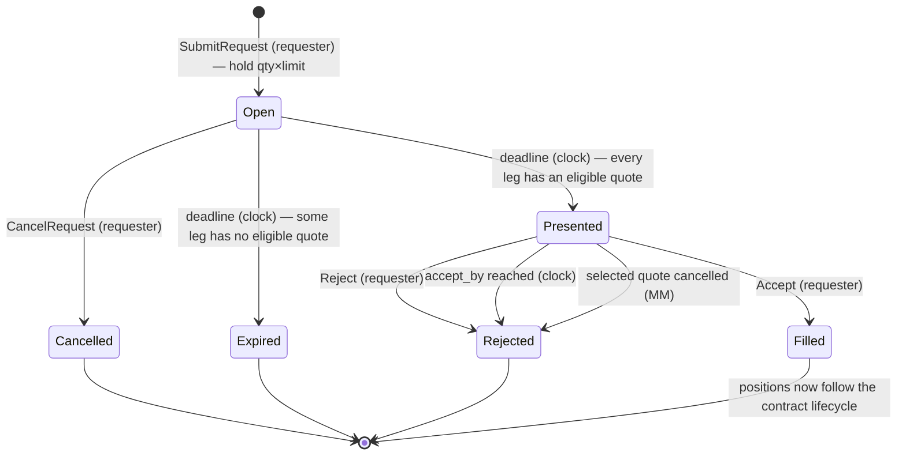
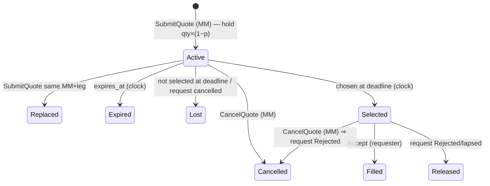
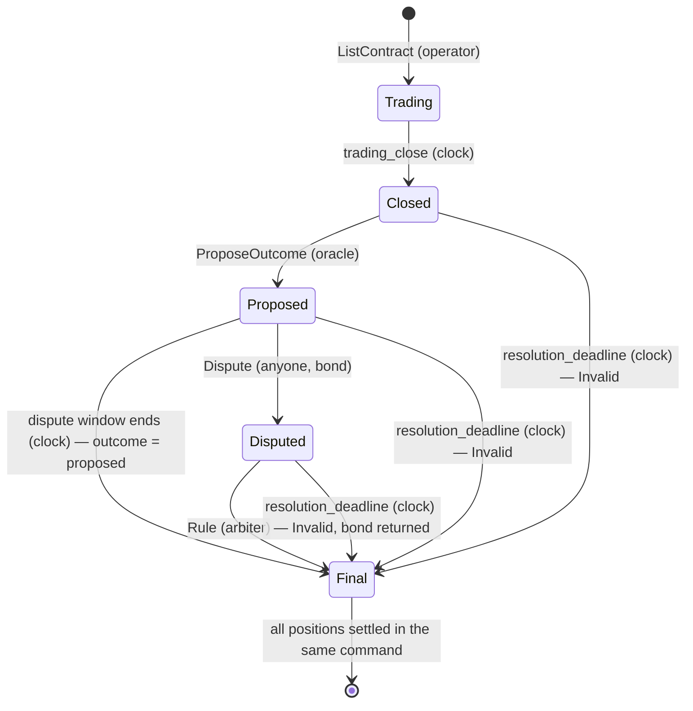

# Engine Spec

Covers deliverable **D1** (state machine) and the behaviour behind **D2**. Product decisions referenced as P#/T# are in [RFC 0001](../rfc/0001-rfq-engine.md).

## 1. Units

| Type | Repr | Notes |
|---|---|---|
| `Amount` | `u64` micro-USD | `$1 = 1_000_000`. All arithmetic `checked_*`; overflow ⇒ command rejected. |
| `Price` | `u16` bps, `1..=9999` | Price of the side the requester buys. `0` and `10000` are invalid (degenerate). |
| `Qty` | `u64` shares | `1..=MAX_QTY` (genesis config). |
| `Timestamp` / `Duration` | `u64` ms | Absolute times only in state. |

Collateral for a leg at price `p`, quantity `q`:
- buyer (requester) locks `q × p × 100`
- counterparty (MM) locks `q × (10000 − p) × 100`
- sum = `q × 1_000_000` exactly. **No rounding exists in the system.**

## 2. Roles

Set in the `Genesis` entry (first log record).

| Role | Can |
|---|---|
| Operator | `Deposit` (mock chain credit), `ListContract` |
| Any account | `Withdraw` (own free funds), `SubmitRequest`, `CancelRequest`, `SubmitQuote`, `CancelQuote`, `Accept`, `Reject`, `Dispute` |
| Contract oracle | `ProposeOutcome` for its contracts |
| Arbiter | `Rule` on disputed contracts |
| System (sequencer) | `Tick` |

Every command carries `actor: AccountId` and `nonce: u64`. The engine requires `nonce > last_nonce[actor]` (else `Duplicate`, nothing consumed). A valid nonce is consumed even if the command is then rejected for business reasons — so retries are idempotent. `Tick` carries no nonce.

## 3. Ledger

Per account: `free`, `reserved`, `escrowed` (all `Amount`). The ledger is the **only** code that mutates balances.

| Op | Move | Used by |
|---|---|---|
| `deposit(a, x)` | external → free | `Deposit` |
| `withdraw(a, x)` | free → external | `Withdraw` |
| `hold(a, x) -> HoldId` | free → reserved | request, quote, dispute bond |
| `release(h)` | reserved → free (whole hold) | cancel, expiry, loss, rejection |
| `escrow(h, x, pos)` | reserved → escrowed (x ≤ hold), remainder released | `Accept` |
| `settle(pos, outcome)` | escrowed → free (winner, or each own lock if `Invalid`) | contract finalisation |
| `forfeit(h, to)` | reserved(a) → free(to) | bond forfeited to treasury |

**Invariants** (checked by `check_invariants()` after every command in tests/debug):

- **I1 Conservation:** Σ over accounts (free + reserved + escrowed) = Σ deposits − Σ withdrawals.
- **I2 Holds:** `account.reserved` = Σ amounts of live holds owned by that account.
- **I3 Escrow:** `account.escrowed` = Σ unsettled position locks for that account; each unsettled position's locks sum to `qty × 1_000_000`.
- **I4 Ownership:** every live hold belongs to exactly one live object (request in `Open`/`Presented`, quote in `Active`/`Selected`, dispute pending). Terminal objects own no holds.
- **I5 No dead ends:** every live object that owns money has a pending timer whose firing moves it to a terminal state.

## 4. Domain objects

```text
Contract { id, description, oracle, trading_close, resolution_deadline, dispute_window, state }
Request  { id, requester, legs: Vec<Leg>, response_deadline, accept_by?, hold, state }
Leg      { contract, side: BuyYes|BuyNo, qty, limit_price, selected_quote? }
Quote    { id, mm, request, leg_index, price, size, expires_at, hold, state }
Position { id, contract, yes_holder, no_holder, qty, yes_lock, no_lock, settled }
Dispute  { contract, disputer, bond_hold }
```

Requester hold at submission = Σ legs `qty × limit_price × 100` (P4).

## 5. Commands → validation → effects

| Command | Validation (any failure ⇒ `CommandRejected`, no state change) | Effects |
|---|---|---|
| `Deposit{to, amount}` | actor is operator | ledger deposit |
| `Withdraw{amount}` | `amount ≤ free` | ledger withdraw |
| `ListContract{...}` | operator; `trading_close < resolution_deadline`; unique id | contract `Trading`; timers for close + hard deadline |
| `SubmitRequest{legs, response_deadline}` | `legs.len() == 1` (P6); contract `Trading`; `now + MIN_RESPONSE ≤ deadline ≤ now + MAX_RESPONSE`; `deadline + ACCEPT_WINDOW < trading_close`; qty/limit in range; free ≥ hold | hold; request `Open`; timer at deadline |
| `CancelRequest{request}` | actor = requester; state `Open` | release request + all quote holds; `Cancelled` |
| `SubmitQuote{request, leg, price, size, expires_at}` | request `Open` and `now < deadline`; `mm ≠ requester`; `price ≤ leg.limit_price`; `size ≥ leg.qty`; `expires_at > now`; MM free ≥ `qty × (10000−price) × 100` (net of any replaced quote) | if MM already has an active quote on this leg → **replace** (release old hold, hold new) atomically; quote `Active`; timer at `expires_at` |
| `CancelQuote{quote}` | actor = mm; quote `Active` or `Selected` | release; quote `Cancelled`; if it was `Selected` → request `Rejected(QuoteWithdrawn)` (§6) |
| `Accept{request, picks: [(leg, quote, price)]}` | actor = requester; state `Presented`; picks equal current selection exactly (ids **and** prices) | per leg: escrow requester `q×p×100` from request hold, escrow MM full quote hold; release requester remainder; create positions; request `Filled`; quotes `Filled` |
| `Reject{request}` | actor = requester; state `Presented` | release all; `Rejected(Declined)` |
| `ProposeOutcome{contract, outcome}` | actor = contract oracle; state `Closed` | `Proposed`; timer at `now + dispute_window` |
| `Dispute{contract}` | state `Proposed`; within window; free ≥ `DISPUTE_BOND` | hold bond; `Disputed` |
| `Rule{contract, outcome}` | actor = arbiter; state `Disputed` | bond returned if `outcome ≠ proposed`, else forfeited to treasury; `Final(outcome)`; settle all positions |
| `Tick` | actor = system | none beyond timer firing |

## 6. State machines (D1)

### 6.1 Request



**Selection at deadline `T`** (fired by the deadline timer, before any command stamped `≥ T`):
- eligible quote: `Active`, `price ≤ limit`, `expires_at ≥ T + ACCEPT_WINDOW` (firm through the whole window — removes passive-expiry griefing).
- best = min price, tie → min `QuoteId` (= earliest seq).
- If every leg has a best: selected quotes → `Selected`; **all other quotes → `Lost`, holds released immediately**; `accept_by = T + ACCEPT_WINDOW`; timer at `accept_by`.
- Else: all quotes `Lost`, request hold released, `Expired`.

Every terminal state other than `Filled` releases **all** holds of the request and its quotes in the same command.

Timers are keyed `(deadline, TimerKey)` and are **stale-safe**: a timer whose object has already left the state it was armed for is a no-op. Timers are never cancelled, only ignored — so no code path can "forget" to cancel one.

### 6.2 Quote



All terminal states except `Filled` release the hold.

### 6.3 Contract (and the positions it holds)



Details in [resolution.md](resolution.md).

## 7. Events

Every event carries `seq` (of the command that caused it) and an `audience` (`Public` or `Account(id)`); gateways filter by audience so **quotes stay sealed** (P7).

`Initialized`, `CommandRejected{reason}`, `Deposited`, `Withdrawn`, `ContractListed`, `ContractClosed`, `RequestOpened` (public: contract, side, qty, deadline; never the limit or the requester), `RequestCancelled`, `RequestExpired`, `RequestPresented` (requester only: picks, accept_by), `RequestRejected{cause}`, `RequestFilled{positions}`, `QuoteSubmitted`/`QuoteReplaced`/`QuoteCancelled`/`QuoteExpired`/`QuoteLost`/`QuoteSelected`/`QuoteReleased`/`QuoteFilled` (quote owner only), `OutcomeProposed`, `Disputed`, `Ruled`, `ContractFinalized{outcome}`, `PositionSettled{payouts}` (to both holders).

On egress the node wraps each command's events in an `EventBatch{seq, origin: Option<(actor, nonce)>, events}`. `origin` lets a client match its command to the ids it created, since `RequestId`/`QuoteId` equal the `seq` of the command that created them.

## 8. Multi-leg design (not built — P6)

The model is already `Vec<Leg>`; enabling N > 1 means removing one validation. The rules that make it atomic:

1. **One hold per request** covering all legs; one hold per quote. No per-leg partial commitment ever exists on the requester side.
2. **Selection is all-or-nothing:** at the deadline every leg needs an eligible quote, else the whole request `Expired` and every hold is released in that one command.
3. **Acceptance is one command:** all legs are validated first (picks match, quotes still `Selected`, amounts fit), then all escrows applied. No fallible step follows the first mutation (T2).
4. **Any leg lost ⇒ whole request lost:** cancelling any `Selected` quote moves the request to `Rejected` and releases *every* leg's quotes and the requester hold.

**"Leg 2 of 3 fails after leg 1 provisionally matched":**

| Moment | Leg 1 | Leg 2 | Leg 3 | Result |
|---|---|---|---|---|
| Before deadline | quote Active (MM-A holds) | no quote | quote Active (MM-C holds) | `Open` — nothing provisional is escrowed |
| Deadline fires | — | no eligible quote | — | request `Expired`; MM-A, MM-C, requester holds all released **in the same command** |
| Alt: deadline OK, then MM-B cancels leg 2 in window | Selected | Cancelled | Selected | request `Rejected(QuoteWithdrawn)`; MM-A, MM-C, requester released in that command |

**Where capital could leak and why it can't:** a "provisional match" is only ever a *hold* owned by a live request/quote with a pending timer (I4, I5). Holds are released only by the transitions above, all inside single commands. The only design that would leak is splitting legs across engines/shards (needs 2PC with prepared holds and timeouts) — forbidden: a request's legs must live in one engine.

## 9. Genesis config (defaults)

| Key | Default |
|---|---|
| `ACCEPT_WINDOW` | 30 s |
| `MIN_RESPONSE` / `MAX_RESPONSE` | 1 s / 7 days |
| `MAX_QTY` | 10^9 |
| `DISPUTE_BOND` | $100 |
| operator, arbiter, treasury | account ids |
