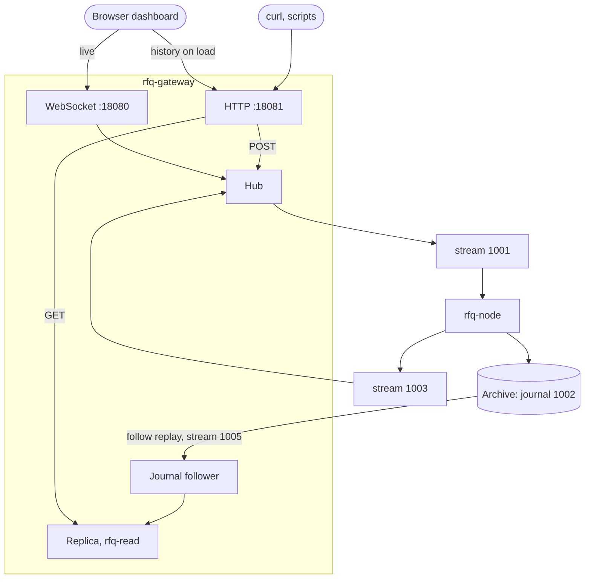

# Read side and HTTP API

Status: design approved by the PO on 2026-10-16.

## 1. Why

The engine only writes. A client learns about its requests, quotes and positions from the events pushed to it while it is connected; nothing can ask "what are my positions?", and a browser tab opened late, or reloaded, starts empty. The trace the dashboard shows exists only in the tab's memory.

This adds a **read side**: a read-only copy of the engine fed by the journal, an **HTTP API** for reads and writes (for curl, scripts and the dashboard), and a **retrievable trace**. The live engine, the sequencer and the journal are unchanged; the engine still never serves a read.

Out of scope: authentication (as for the WebSocket, gateway.md §7), snapshots and journal retention (designed in [transport-aeron.md](transport-aeron.md)), pagination beyond `after_seq`/`limit`, any store other than the journal.

## 2. Shape

| Part | Crate | Does |
|---|---|---|
| Batch builder | `rfq-app` | `batch_of(&SequencedCommand, events, balances) -> Option<EventBatch>`: the node's existing rule for which command produces a batch and what it holds, moved out of `Node::step` so the node and the replica share it. |
| Read accessors | `rfq-domain` | `Engine::positions()` and `Engine::last_nonce(account)`. Read-only; no state, rule or hash changes. |
| Journal follower | `rfq-infra` (feature `aeron`) | Replays the log (stream 1002) from the Archive and keeps following it (§5). |
| Replica | `rfq-read` (new; no I/O) | A read-only `Engine` plus the trace: every `EventBatch` it regenerates, indexed by `seq`, with the command behind it. Answers the queries in §3. |
| HTTP server | `rfq-gateway` | Port 18081. `GET` reads the replica; `POST` enters the hub like a WebSocket command (§4). |

The replica runs in its own thread in the gateway process. HTTP reads take a short read lock; the follower thread takes the write lock per command.

## 3. HTTP API

JSON in and out. Units as on the WebSocket: prices in basis points, money in micro-USD, times in engine milliseconds. A request's id, a quote's id and a contract's id are as in the engine (a request or quote id is the `seq` of the command that created it).

### Reads (served by the replica)

Every read response has `as_of_seq`: the last `seq` the replica has applied. Any read takes `?min_seq=N`: it waits up to 2 s for the replica to reach `N`, else answers `503 {"error":"replica behind","as_of_seq":…}`; a `200` always has `as_of_seq >= N`, a journal reset during the wait included. A client that wants to read its own write passes the `seq` its `POST` returned.

| Endpoint | Returns |
|---|---|
| `GET /v1/status` | `{engine: "up"\|"down", engine_last_seq, replica: {state: "following"\|"catching_up"\|"unavailable", last_seq, state_hash}}`. `engine_last_seq` is the newest `seq` the gateway saw on egress, `null` before any. `catching_up` lasts until the follower first has everything recorded: a gateway that starts while the engine is down, and long enough for its last recording to have stopped (about 10 s), stays `catching_up` until the engine writes (§5). |
| `GET /v1/accounts/{id}` | `{account, balance: {free, reserved, escrowed}, last_nonce}` |
| `GET /v1/accounts/{id}/positions` | `{positions: [{id, contract, request, qty, side: "Yes"\|"No", stake, settled, payout}]}`: the account's side, its own locked amount, and once settled what it was paid. No counterparty. |
| `GET /v1/accounts/{id}/requests` | The account's own requests: `{id, state, response_deadline, legs: [{contract, side, qty, limit_price, selected}]}`. `selected` is `{quote, price}` once the request is presented (what `RequestPresented` tells the requester, and what `Accept` needs), else `null`; the live quote set is never shown (quotes are sealed until the deadline). |
| `GET /v1/accounts/{id}/quotes` | The account's own quotes: `{id, request, leg, price, size, expires_at, state}` |
| `GET /v1/requests?state=open` | Open requests with public fields only: `{id, response_deadline, legs: [{contract, side, qty}]}` (what `RequestOpened` already makes public: no requester, no limit). Optional `&contract=ID`. |
| `GET /v1/contracts`, `GET /v1/contracts/{id}` | `{id, description, oracle, trading_close, resolution_deadline, dispute_window, state}` |
| `GET /v1/trace?view=admin\|{account}&after_seq=N&limit=M` | `{entries, next_after_seq}`; §6. |

Holds and timers are never exposed: they are engine internals. An account's nonce appears only on its own endpoint.

### Writes (through the hub)

| Endpoint | Body | Action |
|---|---|---|
| `POST /v1/requests` | `{actor, nonce?, legs: [{contract, side, qty, limit_price}], response_deadline}` | `SubmitRequest` |
| `POST /v1/quotes` | `{actor, nonce?, request, leg, price, size, expires_at}` | `SubmitQuote` |
| `POST /v1/commands` | `{actor, nonce?, action}` | any client action, in the WebSocket's JSON form |

The call returns once the command's batch is back, or the hub gives up on it:

| Status | When | Body |
|---|---|---|
| `200` | applied | `{seq, nonce, latency_us, rejected: null, events, balances}`: the batch as the actor's view sees it |
| `422` | applied, refused by the engine (nonce consumed) | same, with `rejected: "InsufficientFunds"` (the `CommandRejected` reason) |
| `400` | not JSON, missing or bad fields, a `bad request: …` from the hub | `{error}` |
| `413` | body over 64 KiB | `{error}` |
| `429` | `ingress back-pressured, try again` | `{error}` |
| `503` | `engine unavailable`, or `nonce sync failed for account N` | `{error}` |
| `504` | `outcome unknown: …`, from the hub or from the gateway giving up after it sent the command (§4): resend with the nonce in the body to retry safely | `{error, nonce}` |

Other statuses: `404` unknown route, `405` wrong method, `500` an internal failure (logged).

A reply holds the first chunk of its batch only: the hub sends the `result` right after that chunk (§4). A batch is split into chunks only above 8 MiB (the transport's maximum message). The 64 KiB ingress cap bounds the command, not its batch, which also carries the events of any timers that fired in the same apply, so the bound is not a proof; but 8 MiB is on the order of 100,000 events in one apply, which no workload here comes near. For such a batch the reply would lack the later events (a refusal among them would read as `200`) and the balances, which travel on the last chunk; the trace holds the batch whole.

## 4. Writes go through the hub

A `POST` opens a short-lived connection on the hub's inbox, exactly as a WebSocket connection would: `Open` with its own outbox, a `hello` with the actor's account view, the command with a fresh id, then `Close` once the answer is in. So an HTTP command gets the same nonce book, per-account queue, back-pressure, unresolved-nonce hold and `outcome unknown` handling as a WebSocket one (gateway.md §5, §6), and the hub needs no HTTP code. Connection ids come from one counter shared by the WebSocket acceptor and the HTTP server.

The HTTP handler keeps the batch whose `origin` is `(actor, nonce)` from `sent`, and answers on the matching `result` or `error`. The hub sends the `result` right after the first chunk of the batch, so the reply holds that chunk only (§3); the handler would merge later chunks of the same `seq` that came before the `result`, but none do. It waits at most 75 s, the dashboard's command timeout, which outlasts the hub's 60 s unresolved-nonce hold. Past that, once the hub has sent the command (it may be on ingress), it answers `504 {"error":"outcome unknown: no answer from the gateway","nonce":N}`, and the same `outcome unknown` with the nonce if the hub drops the connection or sends a frame that does not decode; a command never sent (still queued behind another of its actor's) gets `504 {"error":"no answer from the gateway"}` (or `500` for those two).

## 5. The journal follower

1. List the log's recordings (stream 1002) in id order; start with the first.
2. Replay the recording from its start onto stream 1005 with length `INT64_MAX`: the Archive replays what is recorded and, for an active recording, keeps following it as it grows. Subscribe to that replay's session only.
3. Reassemble fragments and decode each `SequencedCommand` (the same codec as the node's replay; a message torn at a crash's stop position never completes, so it is never delivered).
4. When a stopped recording's replay ends, move to the next recording, waiting for the node to create it if needed (the node starts a new recording on every start).
5. Poll the Archive control session (`poll_for_recording_signals`) every loop, so the Archive keeps it open.
6. On any Aeron or Archive failure: log it and set the replica state to `unavailable`; then retry every 1 s with a fresh follower, which rebuilds a replica on the side (step 7). A dead Aeron client is not retried: the gateway exits with status 1 and Docker restarts it. So does a panic in the replica thread, after setting `unavailable`.
7. **Rebuild:** a fresh replica replays from the first recording. The old replica keeps serving until the new one reaches the old one's last `seq`, then the new one is swapped in. After a journal reset (§7) the swap is immediate.

Only recorded data is replayed, and the Archive records with `aeron.archive.file.sync.level=2` (fsync before the recording position moves), so **the replica never shows a command that was not durable**: the same rule as the node's write-ahead gate.

## 6. The trace

The trace is derived from the journal, not stored separately: the journal is the only permanent record (the PO's choice, 2026-10-16). The replica keeps every batch it regenerates, in memory, indexed by `seq`; a gateway restart rebuilds it by replay. Its memory grows with the journal, the same bound as the node's (retention is designed in transport-aeron.md).

A trace entry is the batch as the view sees it (gateway.md §4's `filter`: same events, balances and origin rules as the WebSocket), plus `command: {actor, nonce, action} | null`:
- `view=admin`: every user command;
- `view={account}`: only the account's own commands, the same rule as `origin`.

The command is what lets a reloaded dashboard recover its own limits and quote sizes, which no event carries.

The trace hides the gateway's own probe commands, as the WebSocket does (`Withdraw {amount: 0}`: the nonce probes and the liveness probe, gateway.md §5, §6): such a batch is shown without its `origin` and the probe's rejection, or not at all if nothing else is left, and its `command` is `null`. A client's own `Withdraw` of 0, which the engine always refuses, is hidden the same way.

Paging: entries with `seq > after_seq` (default 0), ascending, at most `limit` (default 500, maximum 1,000). `next_after_seq` is the last returned `seq` when more remain, else `null`. An account view skips batches with nothing for it, as on the WebSocket.

## 7. Consistency

- **The replica equals the node.** It applies the same commands in the same order through the same code, so at the same `seq` its `state_hash` equals the node's, and every batch the node published is identical in the replica's trace. The trace also holds what the node applied without publishing: the `Genesis` batch at `seq` 1, and batches the node replayed after a restart. A test pins both.
- **It lags.** It sees a command once the Archive has recorded it, usually within milliseconds of the node. `min_seq` gives read-your-writes.
- **A sequence break** (a `seq` that is not `last + 1`) triggers a rebuild. `seq` 1 after a higher `seq` means a new journal (`docker compose down -v`): the rebuilt replica starts empty.

## 8. Dashboard

On page load the dashboard fetches the history it missed, alongside its live stream:
1. `GET /v1/status`, then `GET /v1/trace?view=admin` pages from `after_seq = max(0, replica.last_seq − 5,000)` (the newest 5,000 `seq`s at most).
2. The recorder seeds those batches as history: in `seq` order, before the first live batch of the current epoch, skipping any `seq` the live stream already delivered. The live WebSocket starts at page load as today, so nothing is lost while the history loads.
3. The model uses an entry's `command` where the page has no command of its own for that batch.

Lanes, contracts, positions, ledger and trace come back after a reload. The runs table does not: it is the page's own record of the runs it drove. If the history fetch fails (an older gateway, port closed, a malformed response), the page works as today, live only, and says so in a banner; if the replica is not `following`, it shows the history with a banner that it may be incomplete. The HTTP base URL is `http://127.0.0.1:18081`, or `?http=…` on the page URL.

## 9. Security

- The HTTP port binds `127.0.0.1` on the host (in Docker, `0.0.0.0:18081` inside, published on `127.0.0.1` only), like the WebSocket.
- **Host:** a request with a `Host` header must name `localhost`, `127.0.0.1` or `[::1]`, with any port or none (any case), else `403 {"error":"host not allowed"}`, checked before the Origin rule and any handler (`OPTIONS` too). A same-origin `GET` carries no `Origin`, so this is what stops DNS rebinding: a page on another site whose name is made to resolve to 127.0.0.1 still sends its own name in `Host`. Two `Host` headers are a `400`; a request with none (a program) passes.
- **Origin:** a request with an `Origin` header must pass the WebSocket's allowlist (`null`, `http://localhost[:port]`, `http://127.0.0.1[:port]`), else `403`. Allowed origins get `Access-Control-Allow-Origin` (that origin) and `Vary: Origin`; `OPTIONS` preflight answers `204`. Requests without `Origin` pass: programs such as curl, and a page's same-origin `GET`, which the Host rule covers.
- **No authentication** (out of the brief's scope): anyone who can reach the port can act as, or read, any account. Recorded in adversarial.md as an accepted residual; production fixes the account per authenticated session.
- **Limits:** one request per connection (`Connection: close`); request body 64 KiB, with `Content-Length` (no chunked bodies); at most 64 HTTP connections at once (more get `503`); a request's head must arrive within 10 s. The server is the gateway's own, on `std::net` and `httparse` (already a dependency through `tungstenite`): no new HTTP framework.
- **Sealing holds:** public endpoints show only what public events already show; an account's endpoints show only that account's data; a request's live quote set is never shown.

## 10. Testing

- `rfq-read`: every testkit scenario run through a `Node` (in-memory adapters): the replica fed the node's journal reproduces the node's published batches exactly and its `state_hash`; queries return the expected rows; the sealing rules of §3 and §6.
- `rfq-infra`: an `#[ignore]`d live test against the Docker `ArchivingMediaDriver`: the follower delivers every command in order, across a journal restart (a new recording).
- `rfq-gateway`: routing, statuses, CORS and the JSON shapes against a replica built in the test; the write path through a real `HubLoop` with a fake venue.
- End to end: `scripts/http-smoke.mjs` against the Docker stack: fund, list, request, two quotes and accept over HTTP; then positions, balances and the trace over HTTP, the trace equal to the WebSocket's batches.
- Dashboard: the recorder's history seeding and the model's command fallback (unit), the page loading history (page test with a stubbed `fetch`).
- Existing suites stay green; `scripts/demo.sh` still prints `RECOVERY OK`.

## 11. Acceptance

1. `curl` creates a request and a quote and accepts, and reads the resulting position, balances and trace, all over HTTP.
2. A dashboard reload shows the same lanes, positions, ledger and trace as before the reload.
3. The replica's `state_hash` at a `seq` equals the node's logged hash at that `seq`.
4. Nothing in `rfq-node`, the journal or the streams it uses changes behaviour.
